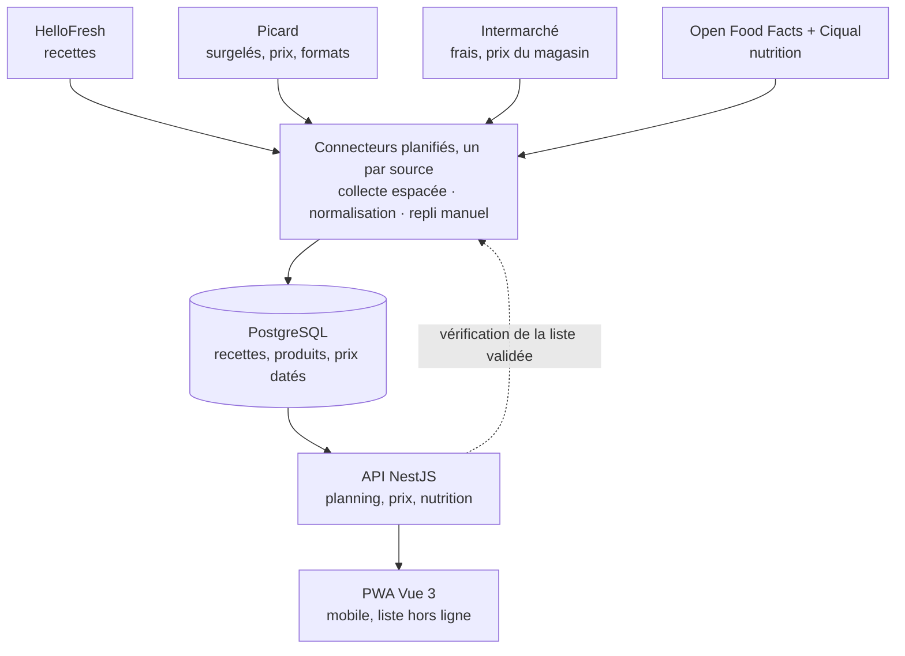
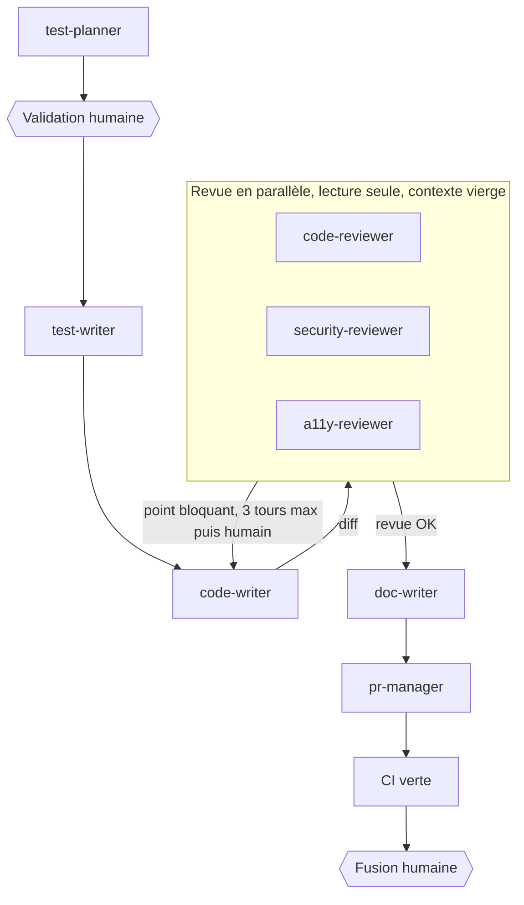

# Cahier des charges

Oct 28, 2026 · @Martin

## 1. Contexte et objectifs

L'application planifie les repas sur 1 ou 2 semaines à partir de recettes, puis génère la liste de courses avec des produits réellement disponibles dans les magasins choisis par l'utilisateur (Picard et Intermarché au lancement).

Je suis le premier utilisateur, mais l'app est conçue pour d'autres : comptes, foyers de 1 à 35 personnes, objectifs et contraintes propres à chacun. Mon besoin sert de cas de référence : une personne, 100 à 200 € par mois, manger équilibré sans passer des heures en cuisine.

**Objectifs mesurables**

- Générer un planning de 7 ou 14 jours en moins de 5 minutes.
- Produire une liste de courses par magasin, sans doublons, quantités agrégées et arrondies au conditionnement vendu.
- Afficher un coût estimé par repas, par portion, par semaine et par mois, puis le coût réel grâce aux tickets de caisse.
- Afficher les valeurs nutritionnelles par portion et par jour (kcal, protéines, glucides, lipides au minimum).
- Proposer en priorité des recettes rapides, avec un temps maximum paramétrable par l'utilisateur.
- Être conforme au RGAA 4.1 niveau AA sur tous les écrans.
- Réduire le gaspillage en réutilisant un même produit sur plusieurs recettes.

## 2. Périmètre et utilisateurs

Deux rôles : utilisateur et administrateur. En V1, l'inscription se fait uniquement sur invitation. Un compte correspond à un foyer de 1 à 35 personnes. L'app est une PWA installable sur mobile, tablette et ordinateur, sans publication sur les stores.

| Inclus | Exclu (pour l'instant) |
| --- | --- |
| Inscription, connexion, profil, foyer de 1 à 35 personnes | Connexion via Google ou Apple |
| Catalogue de recettes : collecte HelloFresh + recettes perso | Commande et paiement en ligne automatiques |
| Choix des enseignes et du magasin le plus proche | Livraison, créneaux de drive |
| Planning 7 / 14 jours sous contraintes (budget, temps, régime, exclusions) | Autres enseignes (architecture prête pour Carrefour, Grand Frais…) |
| Liste de courses par magasin | Suivi médical ou diététique |
| Prix estimé, prix réel via ticket de caisse, statistiques | Application native iOS / Android |
| Valeurs nutritionnelles | Partage public de recettes entre utilisateurs |
| Espace admin, gestion des erreurs, journalisation |  |

## 3. Fonctionnalités

Le MVP tient dans les lignes « Must » : compte et profil, choix du magasin, recettes collectées, planning, liste de courses avec prix et nutrition, et l'admin minimal pour surveiller les collectes. Les priorités se modifient directement dans le tableau.

| Module | Fonctionnalité | Priorité |
| --- | --- | --- |
| Compte | Inscription sur invitation en V1 : e-mail et mot de passe, vérification de l'e-mail | Must |
| Compte | Connexion, déconnexion, mot de passe oublié | Must |
| Compte | Export de mes données et suppression du compte (RGPD) | Must |
| Profil | Foyer : nombre de personnes, de 1 à 35 | Must |
| Profil | Contraintes alimentaires et ingrédients exclus | Must |
| Profil | Objectif (économie, équilibre, rapidité ou mélange) et budget mensuel | Must |
| Profil | Temps de préparation maximum par repas | Should |
| Magasins | Choix des enseignes, puis du magasin le plus proche à partir d'une adresse non enregistrée | Must |
| Magasins | Choix proposé à l'inscription, modifiable au profil et au moment de la liste | Must |
| Magasins | Associer chaque ingrédient à un produit du magasin choisi (prix, format, prix au kg) | Must |
| Magasins | Mise à jour périodique des prix, puis vérification en direct de chaque produit de la liste validée | Must |
| Magasins | Import du catalogue PDF Picard en secours | Could |
| Magasins | Signaler un produit introuvable et proposer un substitut | Could |
| Recettes | Base complète des recettes HelloFresh collectée et stockée chez moi | Must |
| Recettes | Créer ou modifier une recette perso | Must |
| Recettes | Recherche et filtres : temps, kcal, végé, saison, ingrédients | Should |
| Recettes | Favoris et note après dégustation | Could |
| Planning | Générer un planning 7 ou 14 jours (midi et/ou soir) | Must |
| Planning | Remplacer un repas en un clic, ou par glisser-déposer avec alternative au clavier | Must |
| Planning | Respecter budget, objectif, contraintes et temps maximum | Should |
| Planning | Favoriser les recettes qui partagent des ingrédients | Should |
| Planning | Gérer les restes : une recette 4 portions couvre 2 repas | Should |
| Courses | Liste agrégée par magasin puis par rayon, arrondie au conditionnement | Must |
| Courses | Déduire ce qui est déjà au placard | Should |
| Courses | Cocher les articles en magasin, hors connexion | Should |
| Courses | Export ou partage de la liste (texte, PDF) | Could |
| Tickets | Scanner un ticket : lecture des lignes, des prix et du total | Should |
| Tickets | Corriger chaque ligne lue, ou tout saisir à la main | Should |
| Coût et nutrition | Prix estimé par repas, par portion et par semaine | Must |
| Coût et nutrition | Valeurs par portion : kcal, protéines, glucides, lipides | Must |
| Coût et nutrition | Totaux par jour et par semaine comparés aux objectifs | Should |
| Statistiques | Dépenses par semaine, par mois et par plat ; écart estimé / réel | Should |
| Admin | Utilisateurs, collectes, erreurs et journaux (détail section 9) | Must |
| Commande | Remplir automatiquement le panier du drive | Won't (v1) |

## 4. Parcours principal

**Premier lancement** (chaque étape après l'inscription peut être passée et reprise au profil)

1. Inscription sur invitation (V1) : e-mail, mot de passe, vérification de l'e-mail.
2. Foyer : nombre de personnes (1 à 35), contraintes alimentaires, ingrédients exclus.
3. Objectif, budget mensuel, temps maximum par repas.
4. Enseignes : l'utilisateur coche celles qu'il fréquente (Picard, Intermarché), saisit une adresse ou accepte la géolocalisation, puis choisit un magasin par enseigne dans la liste des plus proches. Le magasin choisi est enregistré et modifiable à tout moment ; l'adresse, elle, n'est jamais enregistrée.

**Chaque semaine**

1. Choisir la période (7 ou 14 jours) et les repas à couvrir ; les magasins sont pré-remplis et modifiables.
2. L'app propose un planning compatible avec les produits des magasins choisis.
3. Je remplace les repas qui ne me tentent pas ; prix et nutrition se recalculent en direct.
4. Je valide : liste de courses avec une section par magasin, puis je retire ce que j'ai au placard. L'app vérifie alors en direct la disponibilité de chaque produit dans mes magasins, signale ce qui manque et propose un substitut.
5. En magasin, je coche les articles sur mon téléphone, même sans réseau.
6. Après les courses, je photographie le ticket, je vérifie ou corrige les lignes lues (ou je saisis tout à la main), et le coût réel est enregistré.
7. Pendant la semaine, j'ouvre la recette du jour sur tablette ou téléphone.
8. Je consulte mes statistiques : dépenses par semaine, par mois, par plat, et écart avec le budget.

## 5. Données et sources externes

Toutes les sources sont accessibles sans compte. Le principe : tout collecter une fois en base chez moi, puis mettre à jour par différences, jamais en continu. Le planning ne contacte aucun site ; seule la vérification d'une liste validée interroge les magasins, produit par produit (section 6).

| Source | Données | Méthode retenue | Fréquence |
| --- | --- | --- | --- |
| HelloFresh | Toutes les recettes FR : ingrédients, quantités, portions, étapes, nutrition, temps, photos | Bot de collecte via l'API interne utilisée par le site (principe de HelloFreshCrawler, section 14) ; JSON brut stocké puis normalisé | Collecte initiale étalée sur plusieurs jours, puis uniquement les recettes absentes de la base, toutes les 2 semaines (ou une fois par mois) |
| Picard | Catalogue : prix, format, nutrition, Nutri-Score | Lecture des fiches produits du site ; secours : import du catalogue PDF | Hebdomadaire |
| Picard (magasin) | Disponibilité dans le magasin choisi | À vérifier au lot 0 ; sinon catalogue national supposé disponible | À définir |
| Intermarché | Produits, prix et disponibilité du magasin choisi | Lecture du site pour le magasin sélectionné | Hebdomadaire, magasins utilisés seulement |
| Magasins | Liste des magasins par enseigne avec coordonnées | Localisateur de magasins de chaque enseigne, stocké en base | Mensuelle |
| Adresse saisie | Coordonnées, calculées à la volée, jamais stockées | Géocodage public de la Base Adresse Nationale (gratuit) | À la demande |
| Nutrition | Valeurs pour 100 g | Open Food Facts (produits), Ciqual (ingrédients bruts) | Mensuelle |
| Tickets de caisse | Lignes, prix, total | Photo analysée par OCR, puis validée par l'utilisateur | À chaque course |

**Multi-enseigne.** Chaque enseigne est un connecteur qui implémente la même interface : rechercher les magasins, lister les produits, donner le prix et la disponibilité dans un magasin. Ajouter Carrefour ou Grand Frais revient à écrire un connecteur, sans toucher au reste.

**Modèle de données principal** : Utilisateur → Foyer (personnes, contraintes, objectif, budget) → Magasins choisis. Recette → Ingrédient (quantité, unité) → Ingrédient canonique → Produit (enseigne, magasin, prix daté, nutrition). Planning → Repas → Recette + portions. Liste de courses → Produits. Ticket → Lignes → Produit associé.

## 6. Règles métier

**Correspondance ingrédient → produit.** C'est le cœur du projet et sa partie la plus fragile. Chaque ingrédient de recette est ramené à un ingrédient canonique, lui-même relié à un ou plusieurs produits en magasin.

- Normalisation : minuscules, singulier, suppression des précisions (« 2 gousses d'ail émincées » → ail, 2 gousses).
- Proposition automatique du produit le plus proche (recherche textuelle), puis validation manuelle une seule fois ; l'association est mémorisée.
- Conversion d'unités : g, kg, ml, cl, L, pièce, gousse, c. à soupe, c. à café, avec une table d'équivalences par ingrédient (1 oignon ≈ 150 g, à ajuster).
- Produits de base (sel, poivre, huile) marqués « placard » : hors liste et hors coût par défaut, ou coût forfaitaire.

**Prix par repas.** Deux chiffres affichés, car ils répondent à deux questions différentes :

- Coût consommé : on ne compte que la part du produit utilisée.

```latex
\text{co\^ut consomm\'e} = \sum_i \text{prix au kg}_i \times \text{quantit\'e utilis\'ee}_i
```

- Coût d'achat : ce que je paie réellement en caisse sur la période, conditionnements entiers compris. L'écart entre les deux mesure le gaspillage potentiel.
- Coût par portion = coût consommé ÷ nombre de portions. Chaque prix porte sa date de relevé ; au-delà de 30 jours, il est signalé comme ancien.

**Valeurs nutritionnelles.**

- Calcul par portion à partir des valeurs pour 100 g de chaque produit, pondérées par la quantité utilisée.
- Ordre de priorité des sources : nutrition fournie par la recette HelloFresh, sinon produit magasin (Open Food Facts), sinon ingrédient brut (Ciqual).
- Indicateur de complétude : « 9 ingrédients sur 10 renseignés » plutôt qu'un chiffre faussement précis.
- Affichage par portion, par jour, par semaine ; objectifs journaliers paramétrables.

**Choix du magasin.** L'adresse saisie est géocodée en mémoire, comparée aux coordonnées des magasins en base, puis oubliée : ni stockée, ni journalisée. Seul le magasin choisi est enregistré ; l'utilisateur peut le changer à tout moment, depuis son profil ou au moment de la liste.

**Prix réel et ticket de caisse.**

- Chaque ligne lue est rapprochée d'un produit connu (libellé abrégé du ticket ↔ produit) ; l'utilisateur confirme ou corrige, et l'association est mémorisée.
- Le total lu est comparé à la somme des lignes ; un écart déclenche une demande de vérification.
- Le prix réel devient le prix de référence de ce produit dans ce magasin.
- La photo du ticket est supprimée après validation ; seules les lignes sont conservées.

**Statistiques.** Dépenses par semaine, par mois et par plat (coût réel réparti sur les recettes qui utilisent chaque produit), écart entre estimé et réel, suivi du budget mensuel.

**Disponibilité des produits.** Deux moments, deux sources :

- Pendant le planning : calcul sur la dernière collecte en base ; chaque produit affiche « vérifié le … ».
- Une fois recettes et liste validées : l'app vérifie en direct chaque produit de la liste dans le magasin choisi, une requête par produit, espacées, avec une barre de progression. Les courses n'ayant pas lieu tous les jours, la charge équivaut à une vérification faite à la main.
- Résultat par produit : disponible ; indisponible, avec un substitut proposé ; ou non vérifiable (site injoignable), avec la dernière donnée connue et sa date. Les prix mis à jour recalculent le coût de la liste.

**Ingrédient non trouvé au moment du planning** (seuils proposés, ajustables)

| Situation | Traitement |
| --- | --- |
| Tous les ingrédients trouvés | Recette proposée normalement |
| 1 ou 2 ingrédients secondaires manquants | Recette proposée avec le badge « disponibilité incertaine » et un substitut si possible |
| Ingrédient principal manquant, ou plus de 2 ingrédients | Recette moins prioritaire, remplacée par une autre si possible |
| Pas assez de recettes complètes pour remplir le planning | Meilleures recettes proposées quand même, avec l'avertissement |

Les produits « placard » (sel, huile, épices) n'entrent pas dans ce calcul.

**Liens d'origine.** Chaque recette renvoie vers sa page HelloFresh, chaque produit vers sa fiche sur le site de l'enseigne.

## 7. Design, responsive et accessibilité

Une interface sobre et élégante, lisible avant d'être décorative, utilisable au clavier, au lecteur d'écran et au doigt. Cible : RGAA 4.1 niveau AA, vérifié à chaque livraison.

**Direction visuelle**

- Fond clair et neutre, une seule couleur d'accent, une famille de police très lisible ; mode sombre selon le réglage du système.
- Les photos des plats sont le seul élément riche ; pas d'effets de verre, de néon ni de dégradés appuyés.
- Animations courtes et utiles, coupées si l'utilisateur a demandé à réduire les animations.
- Un design system documenté (couleurs, typographie, espacements, composants) avant le premier écran.

**Responsive** (conception mobile d'abord)

| Support | Largeur | Usage principal |
| --- | --- | --- |
| Mobile | < 640 px | Liste de courses en magasin, recette du jour, scan du ticket |
| Tablette | 640 à 1024 px | Recette en cuisine sur écran posé, planning |
| Ordinateur | > 1024 px | Planification, statistiques, admin |

Navigation en barre basse sur mobile, latérale sur tablette et ordinateur.

**Accessibilité : exigences vérifiables**

- HTML sémantique d'abord : landmarks (header, nav, main), titres hiérarchisés, vraies listes, tableaux avec en-têtes, boutons et liens natifs. ARIA seulement quand le natif ne suffit pas.
- Contrastes : 4,5:1 pour le texte courant, 3:1 pour les grands textes et les éléments d'interface.
- Tout se fait au clavier : focus toujours visible, ordre logique, lien d'évitement vers le contenu.
- Formulaires : label visible sur chaque champ, erreurs liées au champ et annoncées, jamais signalées par la couleur seule.
- Zones tactiles d'au moins 44 × 44 px ; zoom à 200 % sans perte de contenu.
- Glisser-déposer du planning toujours doublé de boutons.
- Changements dynamiques (prix recalculé, article coché, erreur) annoncés au lecteur d'écran.
- Photos de plats avec un texte alternatif utile ; images décoratives ignorées.
- Contrôle : axe-core dans les tests et la CI, audit manuel au lecteur d'écran (NVDA, VoiceOver) à chaque lot, relecture par l'agent accessibilité (section 12).

## 8. Gestion des erreurs et journalisation

Toute erreur est soit gérée et expliquée à l'utilisateur, soit journalisée avec assez de contexte pour être reproduite ; aucune ne disparaît en silence.

**Côté utilisateur**

- Messages en français, sans détail technique, avec une action possible : réessayer, corriger le champ, revenir plus tard.
- Erreurs de formulaire affichées sous le champ concerné et résumées en haut du formulaire.
- Hors connexion : l'app le signale, met les actions en attente et les rejoue au retour du réseau.
- Une source indisponible n'empêche pas le reste : derniers prix connus affichés avec leur date.

**Côté API**

- Un format d'erreur unique pour toute l'API (RFC 9457, « Problem Details ») : code, message, identifiant de requête.
- Filtre global d'exceptions NestJS ; erreurs attendues (validation, droits) distinguées des erreurs inattendues.
- Validation stricte des entrées ; jamais de trace technique renvoyée au navigateur.
- Connecteurs : nouvelles tentatives à délai croissant, puis échec propre, alerte et conservation des dernières données.

**Journaux** (durées de conservation proposées, à valider)

| Type | Contenu | Conservation |
| --- | --- | --- |
| Applicatifs | Logs JSON : niveau, horodatage, identifiant de requête, id utilisateur, route, durée | 30 jours |
| Erreurs | Exception, trace, contexte, version déployée, regroupées par type | 90 jours |
| Collectes | Par exécution : source, début, fin, éléments lus, créés, modifiés, en échec | 1 an |
| Audit | Actions admin et actions sensibles : connexion, mot de passe, suppression de compte | 1 an |
| Front | Erreurs JavaScript et appels API en échec, remontés vers l'API | 30 jours |

- Un identifiant de corrélation suit chaque requête du navigateur à l'API, aux connecteurs et à la base.
- Rien de sensible dans les logs : ni mot de passe, ni jeton, ni adresse saisie ; e-mails masqués.
- Niveaux error, warn, info, debug ; debug coupé en production.
- Alertes sur : hausse anormale des erreurs serveur, collecte en échec, base ou service indisponible.

## 9. Espace admin

L'admin sert à surveiller les collectes, corriger les données et diagnostiquer les erreurs sans jamais ouvrir la base à la main.

| Module | Ce que l'admin voit ou fait |
| --- | --- |
| Tableau de bord | Utilisateurs actifs, dernières collectes, erreurs des dernières 24 h, état des services |
| Utilisateurs | Invitations (créer, envoyer, révoquer), liste, recherche, désactivation, suppression conforme RGPD ; aucun accès aux mots de passe |
| Collectes | Historique par source, relance manuelle, mise en pause d'un connecteur, détail des échecs |
| Catalogue | Recettes et produits, correction manuelle, fusion des doublons |
| Correspondances | File des ingrédients sans produit associé, validation en masse |
| Erreurs et journaux | Recherche par identifiant de requête, utilisateur, niveau, période |
| Enseignes | Activer ou désactiver une enseigne, gérer ses magasins |
| Audit | Qui a fait quoi, et quand, dans l'admin |

Accès réservé au rôle administrateur, avec double authentification ; chaque action est tracée dans le journal d'audit.

## 10. Exigences non fonctionnelles et contraintes

- **Plateformes** : PWA installable sur mobile, tablette et ordinateur ; navigateurs récents (Chrome, Safari, Firefox, Edge).
- **Hors ligne** : liste de courses, recette du jour et planning en cours consultables sans réseau.
- **Performance** : planning 14 jours généré en moins de 3 s ; premier affichage mobile en moins de 2 s en 4G.
- **Sécurité** : mots de passe hachés (Argon2id), session en cookie HttpOnly et Secure, protection CSRF, limitation des tentatives de connexion, double authentification pour l'admin, en-têtes de sécurité (CSP, HSTS), dépendances auditées en CI.
- **RGPD** : données minimales, adresse jamais stockée, photos de tickets supprimées après validation, export et suppression du compte en libre-service, politique de confidentialité.
- **Respect des sites tiers** : collecte espacée (quelques secondes entre deux requêtes), jamais en continu, hors heures de pointe ; aucun site miroir, aucune republication publique, un lien vers la source sur chaque recette.
- **Robustesse** : un connecteur qui casse échoue proprement, garde les dernières données et alerte (section 8).
- **Hébergement** : homelab, conteneurisé ; sauvegarde quotidienne de la base et test de restauration mensuel.
- **Coût** : zéro abonnement visé ; un service payant (OCR, IA) seulement s'il est plafonné.

## 11. Stack technique proposée

Je reste sur ma stack de production pour aller vite : Vue 3 en PWA, NestJS, PostgreSQL, Docker sur le homelab. Le seul élément nouveau est l'outillage de collecte.



Les sites marchands ne sont lus que par les connecteurs : collectes en tâche de fond, et vérification de la liste validée ; si l'un casse, l'app continue avec les derniers prix connus.

| Couche | Choix | Pourquoi |
| --- | --- | --- |
| Front | Vue 3 + Vite en PWA (service worker, IndexedDB), composants accessibles maison | Hors ligne ; une seule base de code pour mobile, tablette et ordinateur |
| API | NestJS + TypeScript | Types partagés avec le front, un module par domaine |
| Authentification | Session en cookie, Argon2id, double authentification (TOTP) pour l'admin | Aucun jeton stocké dans le navigateur |
| Base | PostgreSQL + extension pg\_trgm | Recherche approchée : ingrédient → produit, libellé de ticket → produit |
| Connecteurs | Workers planifiés sur file de tâches (BullMQ + Redis, ou pg-boss pour rester sur PostgreSQL), un par enseigne et par source | Isolés de l'API, relançables, une enseigne = un connecteur |
| OCR des tickets | Tesseract en local, ou modèle de vision ; à départager au lot 0 | Gratuité contre précision |
| Logs et erreurs | Logs JSON (pino), Loki + Grafana, suivi d'erreurs auto-hébergé (GlitchTip ou Sentry) | Recherche par identifiant de requête, alertes |
| Tests | Vitest, Playwright, axe-core | Accessibilité vérifiée à chaque fusion |
| Déploiement | Docker Compose, ou chart Helm dans le cluster existant | Réutilise mon infrastructure GitOps |

## 12. Agents IA et skills

Le développement suit le pipeline d'agents défini dans le projet « Agent IA » : un humain valide le plan de tests et fusionne, les agents font le reste. Ajout propre à ce projet : un a11y-reviewer, en parallèle des deux autres revues.



Une revue bloquante renvoie au code-writer ; après trois allers-retours, la main passe à l'humain. Les reviewers ne voient que l'issue, le plan de tests et le diff.

**Agents**

| Agent | Rôle | Outils | Peut écrire | Modèle indicatif |
| --- | --- | --- | --- | --- |
| test-planner | Liste les tests unitaires, d'intégration et e2e à partir des critères d'acceptation | Read, Grep, Glob, Bash (gh en lecture) | docs/test-plans/ | opus |
| test-writer | Écrit les tests du plan et vérifie qu'ils échouent | Read, Grep, Glob, Edit, Write, Bash | Fichiers de test uniquement | sonnet |
| code-writer | Écrit le code jusqu'à ce que les tests passent | Read, Grep, Glob, Edit, Write, Bash | Tout sauf les tests | sonnet ou opus |
| code-reviewer | Revue neutre du diff | Read, Grep, Glob, Bash | Rien | opus |
| security-reviewer | Autorisations, IDOR, données personnelles, secrets | Read, Grep, Glob, Bash | Rien | opus |
| a11y-reviewer (nouveau) | Conformité RGAA 4.1 AA du diff et du HTML rendu, lecture des résultats axe-core | Read, Grep, Glob, Bash | Rien | opus |
| doc-writer | ADR quand la story introduit une décision | Read, Grep, Glob, Write | docs/ | sonnet |
| pr-manager | Branche, commits, PR liée à l'issue | Read, Bash (git, gh) | Rien | sonnet |

**a11y-reviewer en détail**

- Référentiels : RGAA 4.1 (critères et tests), WCAG 2.2, guide des motifs ARIA (APG), rangés dans un skill qu'il précharge.
- Sortie : un rapport par critère RGAA (conforme, non conforme, non applicable), gravité, correctif proposé.
- Règle : HTML natif avant ARIA ; une non-conformité bloquante renvoie au code-writer.
- Limite : ne remplace pas le test manuel au lecteur d'écran.

**Rules, skills et garde-fous**

| Brique | Contenu pour ce projet |
| --- | --- |
| CLAUDE.md | Stack, commandes, conventions, les 4 principes Karpathy ; moins de 200 lignes |
| Rules | writing-style.md, security.md, typescript.md (paths sur les .ts), accessibility.md (paths sur les .vue) |
| Skills | feature-pipeline (/feature \<issue> : enchaîne les agents, met à jour le kanban), test-plan-format, write-adr, rgaa-checklist |
| Hooks | test-writer limité aux fichiers de test ; code-writer interdit sur les tests |
| Permissions (deny) | Lecture des .env, git push --force, gh pr merge |
| Suivi | GitHub Issues + GitHub Projects |
| CI | gitleaks, Semgrep, Trivy, OSV-Scanner, Renovate, axe-core ; OWASP ZAP en pré-production |

**Sécurité des skills et du code.** Deux outils distincts, à ne pas confondre :

- Skills et agents externes : [SkillSpector](https://github.com/nvidia/skillspector) (NVIDIA). Lire le SKILL.md et les scripts, lancer `skillspector scan <dossier> --no-llm`, puis copier une version figée (commit ou tag), jamais main.
- Code de l'app : [security-audit-skill](https://github.com/cloudflare/security-audit-skill) (Cloudflare), pour un audit complet avant chaque vague d'invitations, en plus du security-reviewer à chaque story.

Mise en place progressive : CLAUDE.md, rules et code-reviewer d'abord, puis un agent à la fois.

## 13. Découpage en lots

Le lot 0 vient avant tout code applicatif ; la journalisation et l'accessibilité entrent dès le lot 1, pas à la fin.

| Lot | Contenu | Terminé quand |
| --- | --- | --- |
| 0. Faisabilité | Prototypes jetables : API HelloFresh FR, 10 fiches Picard, 10 produits Intermarché pour un magasin, localisateurs de magasins, OCR sur 5 tickets | Chaque hypothèse de la section 15 est validée ou a un plan B |
| 1. Socle | Design system, comptes sur invitation, profil foyer, format d'erreur, journalisation, CI avec axe-core | Inscription, connexion et profil fonctionnent, accessibles et journalisés |
| 2. Recettes | Bot HelloFresh, stockage, recherche, recettes perso | Toute la base FR en local, nouvelles recettes ajoutées toutes les 2 semaines |
| 3. Magasins | Connecteurs Picard et Intermarché, choix du magasin, correspondance ingrédient → produit | 80 % des ingrédients de 20 recettes trouvent leur produit |
| 4. Planning et courses | Planning, liste par magasin, prix estimé, nutrition | Je planifie une vraie semaine et fais mes courses avec |
| 5. Tickets et statistiques | Scan, correction, saisie manuelle, statistiques | Un mois de dépenses réelles suivi dans l'app |
| 6. Admin | Tableau de bord, collectes, correspondances, journaux, audit | Une collecte en échec se diagnostique sans ouvrir la base |
| 7. Confort | Hors ligne complet, placard, export, favoris, nouvelles enseignes | Liste utilisée en magasin sans réseau |

## 14. Analyse des outils trouvés

**HelloFreshCrawler** ([dépôt GitHub](https://github.com/alexcodito/HelloFreshCrawler)) : code lu, pas exécuté. Rien de malveillant, la méthode est la bonne, mais il ne récupère pas ce dont on a besoin ; on le réécrit plutôt que de l'utiliser.

| Point | Constat |
| --- | --- |
| Ce qu'il fait | Charge la page d'accueil hellofresh.com, extrait un jeton d'accès présent dans le HTML, interroge l'API interne de recherche de recettes (gw.hellofresh.com) par pages de 500, puis télécharge les fiches recettes en PDF |
| Ce qu'il ne fait pas | Il jette le JSON (ingrédients, quantités, nutrition) et ne garde que les PDF ; c'est pourtant le JSON qui nous intéresse |
| Code | Environ 300 lignes de JavaScript lisibles, 2 dépendances (axios, yargs), aucun script d'installation, paquets venant du registre npm officiel |
| Sécurité | Versions verrouillées anciennes (axios 0.21.4, follow-redirects 1.15.3) qui ont des vulnérabilités publiées depuis |
| Bugs | Nombre de pages arrondi (risque de rater la dernière), PDF déjà téléchargés réécrits à chaque lot, filtre figé à 60 min de préparation |
| Charge sur le site | 10 téléchargements en parallèle, 250 ms entre les lots : trop agressif pour notre règle de collecte |
| Maintenance | Dernier commit le 2 novembre 2024 (ajout du français) ; l'API interne a pu changer depuis |
| France | Le jeton est lu sur hellofresh.com ; il faudra sans doute le lire sur hellofresh.fr |

Décision proposée : un connecteur TypeScript dans notre stack qui reprend le principe (jeton, recherche paginée, JSON), stocke le JSON brut, espace les requêtes de 2 à 5 s, puis ne récupère toutes les 2 semaines que les recettes absentes de la base.

**Piloterr, API Picard Product** ([page](https://www.piloterr.com/fr/library/picard-product)) : service tiers payant qui renvoie une fiche produit picard.fr en JSON, à partir d'une URL ou d'une référence.

- Données annoncées : prix et prix au kilo, images, description, catégories, Nutri-Score, Planet-Score, origine, labels, avis. Ni stock par magasin ni code-barres mentionnés.
- 1 crédit par produit ; 500 crédits offerts à l'inscription, tarifs payants non détaillés sur la page.
- Ils lisent le HTML sans navigateur : bon signe, notre propre connecteur peut faire de même.
- Décision proposée : ne pas en dépendre (payant, un appel par produit, pas de disponibilité en magasin) ; s'en servir comme liste des champs à extraire.

**Catalogue PDF Picard** : bon plan de secours. Extraction du texte du PDF, puis un modèle d'IA structure les lignes en produits (nom, format, prix). Limite confirmée : aucune information de disponibilité par magasin.

## 15. Faisabilité : réponses et points restants

Tes réponses lèvent les doutes sur l'accès aux données ; il reste à le prouver par des prototypes au lot 0.

**Réponses apportées**

| Question | Réponse |
| --- | --- |
| Foyer | Moi seul ; l'app propose de 1 à 35 personnes |
| Magasins | Choisis par l'utilisateur à l'inscription, au profil ou au moment de la liste ; adresse non enregistrée |
| Contraintes alimentaires | Aucune pour moi ; espace dédié dans le profil |
| Objectif | Défini par l'utilisateur ; pour moi : courses simplifiées, équilibré, pas cher, rapide à cuisiner |
| Plateforme | Web, PWA |
| Budget | Défini par l'utilisateur ; pour moi 100 à 200 € par mois |
| HelloFresh | Recettes accessibles par URL ; collecte complète en base |
| Picard | Catalogue accessible sans compte ; catalogue PDF en secours |
| Intermarché | Le site donne les produits et les prix du magasin |
| Collecte | Rien de bloquant trouvé tant qu'on ne collecte pas en continu et qu'on ne crée ni miroir ni service concurrent |

**Hypothèses à prouver au lot 0**

- [ ] L'API interne HelloFresh répond pour la France et renvoie ingrédients, quantités et nutrition.
- [ ] Les fiches Picard se lisent sans navigateur ; la disponibilité par magasin est exposée ou non.
- [ ] Intermarché expose prix et disponibilité d'un magasin donné, lisibles automatiquement.
- [ ] Les localisateurs Picard et Intermarché donnent les coordonnées de chaque magasin.
- [ ] L'OCR lit correctement au moins 90 % des lignes sur 5 tickets réels.
- [ ] Open Food Facts couvre une part suffisante des produits (mesure sur 50 produits).
- [ ] La correspondance ingrédient → produit atteint 80 % de propositions correctes.

**Point juridique : tranché**

J'ai vérifié les conditions des trois sites : pas d'obstacle tant que la collecte reste espacée et qu'on ne crée ni miroir ni service concurrent. La V1 reste sur invitation.
