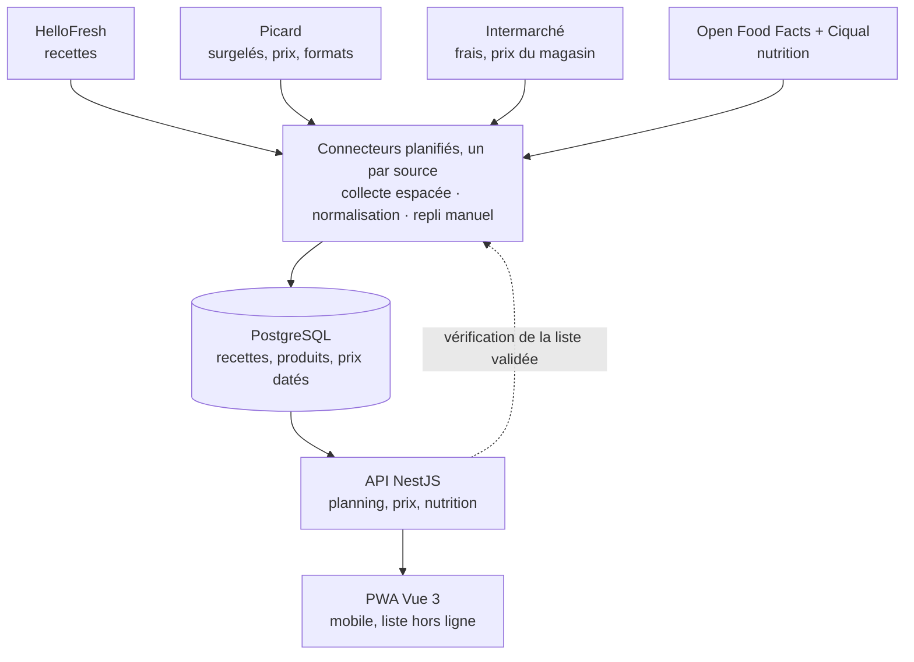
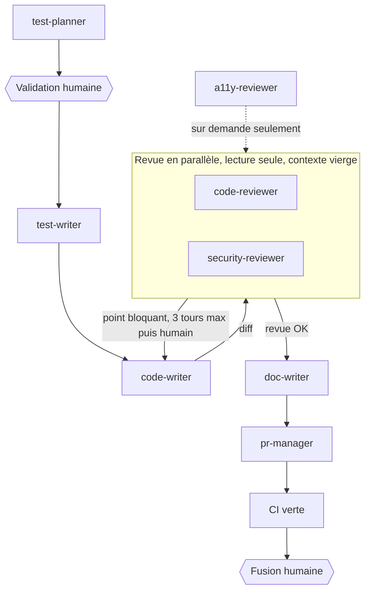

# Cahier des charges

Oct 28, 2026 · @Martin

## 1. Contexte et objectifs

L'application planifie les repas sur 1 ou 2 semaines à partir de recettes, puis génère la liste de courses avec des produits réellement disponibles dans les magasins choisis par l'utilisateur (Picard et Intermarché au lancement).

Je suis le premier utilisateur, mais l'app est conçue pour d'autres : comptes, foyers de 1 à 35 personnes, objectifs et contraintes propres à chacun. Mon besoin sert de cas de référence : une personne, 100 à 200 € par mois, manger équilibré sans passer des heures en cuisine.

**Objectifs mesurables**

- Générer un planning de 7 ou 14 jours en moins de 5 minutes.
- Produire une liste de courses par magasin, sans doublons, quantités agrégées et arrondies au conditionnement vendu.
- Afficher un coût estimé par repas, par portion, par semaine et par mois, puis le coût réel grâce aux tickets de caisse. Ce coût reste partiel jusqu'aux premières courses : il indique combien de produits n'ont pas encore de prix.
- Afficher les valeurs nutritionnelles par portion et par jour (kcal, protéines, glucides, lipides au minimum).
- Proposer en priorité des recettes rapides, avec un temps maximum paramétrable par l'utilisateur.
- Rester utilisable au clavier et lisible (socle d'accessibilité de base), sans viser de conformité RGAA formelle : la sécurité et l'UX/UI passent en premier.
- Réduire le gaspillage en réutilisant un même produit sur plusieurs recettes.

## 2. Périmètre et utilisateurs

Deux rôles : utilisateur et administrateur. En V1, l'inscription se fait uniquement sur invitation. Un compte correspond à un foyer de 1 à 35 personnes. L'app est une PWA installable sur mobile, tablette et ordinateur, sans publication sur les stores.

| Inclus                                                                     | Exclu (pour l'instant)                                             |
| -------------------------------------------------------------------------- | ------------------------------------------------------------------ |
| Inscription, connexion, profil, foyer de 1 à 35 personnes                  | Connexion via Google ou Apple                                      |
| Catalogue de recettes : collecte HelloFresh + recettes perso               | Commande et paiement en ligne automatiques                         |
| Choix des enseignes et du magasin le plus proche                           | Livraison, créneaux de drive                                       |
| Planning 7 / 14 jours sous contraintes (budget, temps, régime, exclusions) | Autres enseignes (architecture prête pour Carrefour, Grand Frais…) |
| Liste de courses par magasin                                               | Suivi médical ou diététique                                        |
| Prix estimé, prix réel via ticket de caisse, statistiques                  | Application native iOS / Android                                   |
| Valeurs nutritionnelles                                                    | Partage public de recettes entre utilisateurs                      |
| Espace admin, gestion des erreurs, journalisation                          |                                                                    |

## 3. Fonctionnalités

Le MVP tient dans les lignes « Must » : compte et profil, choix du magasin, recettes collectées, planning, liste de courses avec prix et nutrition, et l'admin minimal pour surveiller les collectes. Les priorités se modifient directement dans le tableau.

| Module            | Fonctionnalité                                                                                                                                                                                                                | Priorité   |
| ----------------- | ----------------------------------------------------------------------------------------------------------------------------------------------------------------------------------------------------------------------------- | ---------- |
| Compte            | Inscription sur invitation en V1 : e-mail et mot de passe, vérification de l'e-mail                                                                                                                                           | Must       |
| Compte            | Connexion, déconnexion, mot de passe oublié                                                                                                                                                                                   | Must       |
| Compte            | Export de mes données et suppression du compte (RGPD)                                                                                                                                                                         | Must       |
| Profil            | Foyer : nombre de personnes, de 1 à 35 (quantités estimées au-delà de 6)                                                                                                                                                      | Must       |
| Profil            | Contraintes alimentaires et ingrédients exclus                                                                                                                                                                                | Must       |
| Profil            | Objectif (économie, équilibre, rapidité ou mélange) et budget mensuel                                                                                                                                                         | Must       |
| Profil            | Temps de préparation maximum par repas                                                                                                                                                                                        | Should     |
| Magasins          | Choix des enseignes, puis du magasin le plus proche à partir d'une adresse non enregistrée                                                                                                                                    | Must       |
| Magasins          | Choix proposé à l'inscription, modifiable au profil et au moment de la liste                                                                                                                                                  | Must       |
| Magasins          | Associer chaque ingrédient à un produit : suggestion Picard, produit Intermarché (générique ou lien collé), ou recherche par l'utilisateur ; trois suggestions sans présélection, choix mémorisé par ingrédient et modifiable | Must       |
| Magasins          | Mise à jour périodique des prix, puis vérification en direct de chaque produit de la liste validée (selon l'enseigne, pas Intermarché)                                                                                        | Must       |
| Magasins          | Import du catalogue PDF Picard en secours                                                                                                                                                                                     | Could      |
| Magasins          | Signaler un produit introuvable et proposer un substitut                                                                                                                                                                      | Could      |
| Recettes          | Base complète des recettes HelloFresh collectée et stockée chez moi                                                                                                                                                           | Must       |
| Recettes          | Créer ou modifier une recette perso                                                                                                                                                                                           | Must       |
| Recettes          | Recherche et filtres : temps, kcal, végé, cuisine, difficulté, ingrédients ; saison déduite des ingrédients                                                                                                                   | Should     |
| Recettes          | Favoris et note après dégustation                                                                                                                                                                                             | Could      |
| Planning          | Générer un planning 7 ou 14 jours (midi et/ou soir)                                                                                                                                                                           | Must       |
| Planning          | Remplacer un repas en un clic, ou par glisser-déposer avec alternative au clavier                                                                                                                                             | Must       |
| Planning          | Respecter budget, objectif, contraintes et temps maximum                                                                                                                                                                      | Should     |
| Planning          | Limiter le nombre d'ingrédients différents : favoriser les recettes qui partagent des ingrédients, surtout les bases qui se conservent                                                                                        | Must       |
| Planning          | Gérer les restes : une recette 4 portions couvre 2 repas                                                                                                                                                                      | Should     |
| Courses           | Liste agrégée par magasin puis par rayon, arrondie au conditionnement                                                                                                                                                         | Must       |
| Courses           | Déduire ce qui est déjà au placard, y compris les restes de paquets entamés par les recettes précédentes                                                                                                                      | Must       |
| Courses           | Cocher les articles en magasin, hors connexion                                                                                                                                                                                | Should     |
| Courses           | Export ou partage de la liste (texte, PDF)                                                                                                                                                                                    | Could      |
| Tickets           | Importer un ticket : PDF dématérialisé lu directement (voie principale, exacte au lot 0), ou photo d'un ticket papier lue par OCR ; import des factures drive (PDF) pour amorcer le catalogue personnel                       | Must       |
| Tickets           | Valider ou corriger chaque ligne lue, ou saisir les prix depuis la liste ; produits connus mis à jour, nouveaux produits ajoutés                                                                                              | Must       |
| Coût et nutrition | Prix estimé par repas, par portion et par semaine ; partiel tant que des produits n'ont pas de prix, avec leur nombre affiché                                                                                                 | Must       |
| Coût et nutrition | Valeurs par portion : kcal, protéines, glucides, lipides ; sources citées avec liens et licences (Open Food Facts, Ciqual)                                                                                                    | Must       |
| Coût et nutrition | Totaux par jour et par semaine comparés aux objectifs                                                                                                                                                                         | Should     |
| Statistiques      | Dépenses par semaine, par mois et par plat ; écart estimé / réel                                                                                                                                                              | Should     |
| Admin             | Utilisateurs, collectes, erreurs et journaux (détail section 9)                                                                                                                                                               | Must       |
| Commande          | Remplir automatiquement le panier du drive                                                                                                                                                                                    | Won't (v1) |

## 4. Parcours principal

**Premier lancement** (chaque étape après l'inscription peut être passée et reprise au profil)

1. Inscription sur invitation (V1) : e-mail, mot de passe, vérification de l'e-mail.
2. Foyer : nombre de personnes (1 à 35 ; au-delà de 6, quantités estimées), contraintes alimentaires, ingrédients exclus.
3. Objectif, budget mensuel, temps maximum par repas.
4. Enseignes : l'utilisateur coche celles qu'il fréquente (Picard, Intermarché), saisit une adresse ou accepte la géolocalisation, puis choisit un magasin par enseigne dans la liste des plus proches. Le magasin choisi est enregistré et modifiable à tout moment ; l'adresse, elle, n'est jamais enregistrée.

**Chaque semaine**

1. Choisir la période (7 ou 14 jours) et les repas à couvrir ; les magasins sont pré-remplis et modifiables.
2. L'app propose un planning compatible avec les produits des magasins choisis.
3. Je remplace les repas qui ne me tentent pas ; prix et nutrition se recalculent en direct.
4. Je valide : liste de courses avec une section par magasin, puis je retire ce que j'ai au placard. L'app vérifie alors en direct la disponibilité chez les enseignes qui le permettent (chez Picard, disponibilité nationale), signale ce qui manque et propose un substitut ; pour Intermarché, elle me donne un lien de recherche à ouvrir moi-même.
5. En magasin, je coche les articles sur mon téléphone, même sans réseau.
6. Après les courses, j'importe le ticket en PDF (ou je photographie le ticket papier) et je valide ou corrige chaque ligne, ou je saisis le prix de chaque produit depuis ma liste ; les produits connus sont mis à jour, les nouveaux sont ajoutés.
7. Pendant la semaine, j'ouvre la recette du jour sur tablette ou téléphone.
8. Je consulte mes statistiques : dépenses par semaine, par mois, par plat, et écart avec le budget.

## 5. Données et sources externes

Toutes les sources sont accessibles sans compte. Le principe : tout collecter une fois en base chez moi, puis mettre à jour par différences, jamais en continu. Le planning ne contacte aucun site ; seule la vérification d'une liste validée interroge les magasins, produit par produit (section 6).

| Source            | Données                                                                                                                                                                      | Méthode retenue                                                                                                                                                                                                                                                           | Fréquence                                                                                                                                                                                                                                                                                                   |
| ----------------- | ---------------------------------------------------------------------------------------------------------------------------------------------------------------------------- | ------------------------------------------------------------------------------------------------------------------------------------------------------------------------------------------------------------------------------------------------------------------------- | ----------------------------------------------------------------------------------------------------------------------------------------------------------------------------------------------------------------------------------------------------------------------------------------------------------- |
| HelloFresh        | Toutes les recettes FR : ingrédients, quantités, portions, étapes, nutrition, temps, photos                                                                                  | Bot de collecte via l'API interne (jeton public lu sur hellofresh.fr, valable 30 jours) ; un seul appel de recherche paginé renvoie tout, sans appel par recette ; JSON brut stocké (environ 370 Mo pour 14 856 recettes) puis normalisé                                  | Collecte initiale en une soirée environ (1 486 requêtes à 4 s, moins si des pages plus grandes sont acceptées), puis uniquement les recettes absentes de la base, toutes les 2 semaines (ou une fois par mois), en parcourant les premières pages (les plus récentes d'abord) jusqu'à retomber sur du connu |
| Picard            | Catalogue : prix, prix au kilo, conditionnement, disponibilité nationale, code-barres, Planet-Score (Nutri-Score absent de l'échantillon, nutrition pour 100 g non vérifiée) | Collecte par le sitemap publié par Picard (1 605 fiches), jamais par la recherche ; microdonnées schema.org (prix, disponibilité, code-barres) lues sans navigateur ; mise à jour incrémentale par date de modification ; secours : catalogue PDF                         | Hebdomadaire                                                                                                                                                                                                                                                                                                |
| Picard (magasin)  | Disponibilité dans le magasin choisi                                                                                                                                         | Existe sur le site, mais sur un chemin interdit par le robots.txt : disponibilité nationale seulement                                                                                                                                                                     | Sans objet                                                                                                                                                                                                                                                                                                  |
| Intermarché       | Produits, prix et disponibilité du magasin choisi                                                                                                                            | Aucune collecte (site protégé contre les robots) : produits génériques, prix issus des tickets et de la saisie (section 6)                                                                                                                                                | Sans objet (prix apportés par les tickets)                                                                                                                                                                                                                                                                  |
| Magasins          | Liste des magasins par enseigne avec coordonnées                                                                                                                             | Localisateur de magasins de chaque enseigne, stocké en base (Picard : sitemap officiel de magasins.picard.fr, 1 267 magasins, adresse complète ; Intermarché : OpenStreetMap, environ 2 280 magasins, ville complétée par géocodage inverse, sans requête vers leur site) | Mensuelle                                                                                                                                                                                                                                                                                                   |
| Adresse saisie    | Coordonnées, calculées à la volée, jamais stockées                                                                                                                           | Géocodage de la Base Adresse Nationale, porté par l'IGN (data.geopf.fr/geocodage), gratuit ; sert aussi au géocodage inverse de la ville des magasins                                                                                                                     | À la demande                                                                                                                                                                                                                                                                                                |
| Nutrition         | Valeurs pour 100 g                                                                                                                                                           | Open Food Facts, API v3.6 (produits à code-barres : 47 sur 50 trouvés au lot 0 ; 15 lectures par minute, cache obligatoire) ; Ciqual 2025 de l'ANSES (aliments génériques : 3 484 aliments, fichiers XML, licence Etalab 2.0)                                             | Mensuelle                                                                                                                                                                                                                                                                                                   |
| Tickets de caisse | Lignes, prix, total                                                                                                                                                          | PDF dématérialisé lu sans OCR (exact au lot 0), sinon photo analysée par OCR ; toujours validé par l'utilisateur                                                                                                                                                          | À chaque course                                                                                                                                                                                                                                                                                             |

**Multi-enseigne.** Chaque enseigne est un connecteur qui implémente la même interface : rechercher les magasins, lister les produits, donner le prix et la disponibilité dans un magasin. Ajouter Carrefour ou Grand Frais revient à écrire un connecteur, sans toucher au reste. Un connecteur peut n'implémenter qu'une partie de l'interface : celui d'Intermarché ne fait que rechercher les magasins, les autres méthodes répondent « non disponible ».

**Modèle de données principal** : Utilisateur → Foyer (personnes, contraintes, objectif, budget) → Magasins choisis. Plat → Recette (variantes reliées par le préfixe de code) → Palier de portions (1 à 6) → Ingrédient (quantité, unité) → Ingrédient canonique → Produit (enseigne, magasin, prix daté, nutrition). Planning → Repas → Recette + portions. Liste de courses → Produits. Ticket → Lignes → Produit associé.

## 6. Règles métier

**Correspondance ingrédient → produit.** C'est le cœur du projet et sa partie la plus fragile. Chaque ingrédient de recette est ramené à un ingrédient canonique, lui-même relié à un ou plusieurs produits en magasin.

- Normalisation : minuscules, singulier, suppression des précisions (« 2 gousses d'ail émincées » → ail, 2 gousses).
- Trois suggestions classées, calculées localement sur le catalogue déjà collecté (normalisation, ingrédient canonique, pondération des mots rares, exclusion des plats cuisinés, préférence pour l'aliment cru, recouvrement minimum du nom) ; aucune n'est présélectionnée et « aucun de ces produits » est proposé en premier. Validation une seule fois par ingrédient canonique, modifiable ensuite.
- Conversion d'unités : g, kg, ml, cl, L, pièce, gousse, c. à soupe, c. à café, avec une table d'équivalences par ingrédient (1 oignon ≈ 150 g, à ajuster). Unités réellement rendues par HelloFresh : g, ml, pièce(s), cc, cs, sachet(s), paquet(s), pot(s), cm et « selon le goût » ; ces deux dernières ne se convertissent pas et sont traitées comme quantité non chiffrée.
- Produits de base (sel, poivre, huile) marqués « placard » : hors liste et hors coût par défaut, ou coût forfaitaire. Première liste automatique : les ingrédients que HelloFresh ne livre pas (\`shipped: false\`), à affiner à la main.

**Choix du produit par ingrédient.** Mesuré au lot 0 : la bonne correspondance figure dans les trois premières suggestions pour 86 % des ingrédients côté Picard et 89 % côté Ciqual (contre 64 % et 79 % pour un rapprochement naïf). Mais pour un ingrédient que la source ne vend pas, une suggestion inutile apparaît encore environ une fois sur trois côté Picard (31 %) et une fois sur deux côté Ciqual (50 %) : la validation par l'utilisateur reste le mécanisme principal. Pour chaque ingrédient, l'utilisateur choisit :

- un produit Picard suggéré, tiré du catalogue local ;
- « chez Intermarché », en produit générique ou en collant le lien d'un produit du site (le code-barres est extrait du lien, sans requête) ;
- ou il cherche lui-même via un lien vers le site de l'enseigne, puis revient valider.

Le choix est mémorisé par ingrédient. Picard ne couvre qu'une partie des ingrédients à acheter (bon équivalent pour 22 sur 65, soit 34 % ; équivalent utilisable pour 33 sur 65, soit 51 % : surgelés, viandes, herbes) ; le reste va par défaut chez Intermarché.

**Code-barres.** C'est la clé de rapprochement entre un produit magasin, Open Food Facts et une ligne de ticket. Un produit peut en avoir plusieurs.

**Prix par repas.** Deux chiffres affichés, car ils répondent à deux questions différentes :

- Coût consommé : on ne compte que la part du produit utilisée.

```latex
\text{co\^ut consomm\'e} = \sum_i \text{prix au kg}_i \times \text{quantit\'e utilis\'ee}_i
```

- Coût d'achat : ce que je paie réellement en caisse sur la période, conditionnements entiers compris. L'écart entre les deux mesure le gaspillage potentiel.
- Coût par portion = coût consommé ÷ nombre de portions. Chaque prix porte sa date de relevé ; au-delà de 30 jours, il est signalé comme ancien.

**Valeurs nutritionnelles.**

- Calcul par portion à partir des valeurs pour 100 g de chaque produit, pondérées par la quantité utilisée. HelloFresh fournit déjà 9 valeurs par portion, avec le poids de la portion : elles servent de référence et de recoupement, sans se cumuler avec notre calcul.
- Ordre de priorité des sources : nutrition fournie par la recette HelloFresh, sinon produit magasin (Open Food Facts), sinon ingrédient brut (Ciqual). Open Food Facts : une valeur n'est utilisée que si elle est donnée pour 100 g (champ \`source\_per\`), et l'app indique si elle est lue sur l'emballage ou estimée. Ciqual : rapprochement validé à la main, en tenant compte de l'état cru ou cuit ; « traces » et « < x » comptent pour zéro, « - » reste inconnu.
- Indicateur de complétude : « 9 ingrédients sur 10 renseignés » plutôt qu'un chiffre faussement précis. Contrôle à l'import : énergie recalculée (4 kcal/g pour protéines et glucides, 9 pour les lipides, 2 pour les fibres) ; au-delà de 30 % d'écart, la valeur est signalée comme douteuse, jamais rejetée en silence.
- Affichage par portion, par jour, par semaine ; objectifs journaliers paramétrables.

**Choix du magasin.** L'adresse saisie est géocodée en mémoire, comparée aux coordonnées des magasins en base, puis oubliée : ni stockée, ni journalisée. Seul le magasin choisi est enregistré ; l'utilisateur peut le changer à tout moment, depuis son profil ou au moment de la liste. Champs nécessaires au choix : nom, ville, coordonnées ; l'adresse complète est affichée quand elle existe. Le géocodage inverse ne sert qu'à la ville et au code postal, jamais à la rue (fausse 2 fois sur 3 au lot 0). Chaque magasin affiche sa provenance (site officiel ou OpenStreetMap) et l'utilisateur peut signaler un magasin fermé ou mal placé.

**Prix réels : tickets de caisse et saisie.**

- Après les courses, deux façons d'alimenter les prix : scanner le ticket, ou saisir le prix de chaque produit depuis la liste de courses, déjà pré-remplie.
- Scan : chaque ligne lue est rapprochée d'un produit connu (libellé abrégé du ticket ↔ produit). L'utilisateur valide, corrige ou supprime chaque ligne ; rien n'est enregistré sans sa validation.
- Produit déjà connu : son prix est mis à jour, l'ancien est conservé dans l'historique (statistiques, évolution des prix). Produit inconnu : il est créé (nom, format, prix, magasin), puis associé à l'ingrédient correspondant.
- Le total lu est comparé à la somme des lignes ; un écart déclenche une demande de vérification. Les remises sont des lignes à part : le prix de référence d'un produit est celui de sa ligne, et le budget se calcule sur le total réellement payé. Sur une facture drive, les prix viennent du prix unitaire de chaque ligne ; les frais de livraison ou de service comptent dans les dépenses, pas dans le coût d'un repas. Les libellés complets d'une facture drive (marque, conditionnement, rayon) amorcent le catalogue personnel des produits habituels ; ses prix, souvent anciens, ne servent qu'en dernier recours. Une association libellé de ticket → produit, validée une fois, est mémorisée : les libellés tronqués ne sont rapprochés automatiquement qu'environ une fois sur deux.
- Toute pièce importée (photo, PDF de ticket, facture) est supprimée après validation ; seules les lignes d'articles, la date, le magasin et le total sont conservés.

**Niveaux de prix.** Chaque prix affiche sa provenance, pour qu'une estimation ne passe jamais pour un prix réel.

| Niveau             | Source                                                                                                                                                                                | Affichage                                                                   |
| ------------------ | ------------------------------------------------------------------------------------------------------------------------------------------------------------------------------------- | --------------------------------------------------------------------------- |
| Réel               | Ticket (PDF ou photo) ou saisie dans ce magasin, moins de 30 jours                                                                                                                    | Prix et date                                                                |
| Catalogue enseigne | Prix lu sur le site de l'enseigne (Picard), avec sa date et sa fin de validité. C'est le prix de vente en ligne : son égalité avec le prix en magasin n'est pas vérifiée              | Prix, date et mention « prix en ligne »                                     |
| Ancien             | Ticket ou saisie de plus de 30 jours                                                                                                                                                  | Prix et date, signalé comme ancien                                          |
| Estimé             | Relevé du même produit dans un autre magasin de l'enseigne ; facture drive importée (souvent ancienne) ; Open Prices seulement pour la même enseigne et un relevé de moins de 12 mois | « environ », avec la source et la date                                      |
| Inconnu            | Aucune donnée                                                                                                                                                                         | « prix inconnu » ; le coût du repas indique le nombre de produits sans prix |

Picard : prix catalogue collectés chaque semaine, remplacés par le prix réel dès qu'un ticket le donne. Intermarché : aucune collecte automatique, les tickets, les factures et la saisie sont les seules sources. Les prix relevés dans un magasin servent à tous les utilisateurs de ce magasin, sans indiquer qui a fait les courses.

**Statistiques.** Dépenses par semaine, par mois et par plat (coût réel réparti sur les recettes qui utilisent chaque produit), écart entre estimé et réel, suivi du budget mensuel.

**Disponibilité des produits.** Deux moments, deux sources :

- Pendant le planning : calcul sur la dernière donnée connue ; chaque produit affiche « vérifié le … ».
- Une fois recettes et liste validées : vérification en direct, produit par produit, seulement pour les enseignes qui l'autorisent (Picard : disponibilité nationale lue sur la fiche produit, affichée comme telle et non comme celle du magasin). Une requête par produit, espacées, avec une barre de progression.
- Intermarché : aucune vérification automatique, le site étant protégé contre les robots. L'app propose pour chaque produit un lien de recherche sur le site d'Intermarché, que l'utilisateur ouvre lui-même ; il coche disponible ou indisponible, et la réponse est mémorisée avec sa date.
- Résultat par produit : disponible ; indisponible, avec un substitut proposé ; ou non vérifié, avec la dernière donnée connue et sa date. Les prix mis à jour recalculent le coût de la liste.

**Ingrédient non trouvé au moment du planning** (seuils proposés, ajustables)

| Situation                                                | Traitement                                                                              |
| -------------------------------------------------------- | --------------------------------------------------------------------------------------- |
| Tous les ingrédients trouvés                             | Recette proposée normalement                                                            |
| 1 ou 2 ingrédients secondaires manquants                 | Recette proposée avec le badge « disponibilité incertaine » et un substitut si possible |
| Ingrédient principal manquant, ou plus de 2 ingrédients  | Recette moins prioritaire, remplacée par une autre si possible                          |
| Pas assez de recettes complètes pour remplir le planning | Meilleures recettes proposées quand même, avec l'avertissement                          |

Les produits « placard » (sel, huile, épices) n'entrent pas dans ce calcul.

**Liens d'origine.** Chaque produit renvoie vers sa fiche sur le site de l'enseigne. Pour les recettes, le lien HelloFresh (règle `{slug}-{id}`) n'est affiché qu'après avoir vérifié qu'il répond, au moment où la recette entre dans un planning. Sinon, la recette est marquée « Recette HelloFresh », sans lien.

**Portions.** HelloFresh donne des quantités distinctes pour 1 à 6 portions, non proportionnelles (épices inchangées, arrondis au conditionnement). Chaque palier est stocké tel quel, jamais recalculé par multiplication. Au-delà de 6 personnes, les quantités sont obtenues en combinant des paliers réels (8 = 4 + 4, 10 = 6 + 4) et affichées comme estimées.

**Catalogue HelloFresh.**

- Exclus du planning, sans être supprimés : extras et épicerie (`isAddon`, tags `addon-recipe`, `grocery-dairy`, `breakfast-kits`, `sides-delicacies`).
- Republication ou variante : même préfixe de `uniqueRecipeCode` et ingrédients identiques = republication, on fusionne et on garde la plus récente (`updatedAt`). Même préfixe et un seul ingrédient différent = variante (infixe `-SS-` pour une substitution comme sans gluten ou riz précuit, `-SP-` pour une montée en gamme comme Label Rouge), on garde les deux et on les relie. Le préfixe seul ne suffit pas : nom normalisé en complément, puis revue manuelle des cas litigieux.
- Variantes au planning : un plat n'est proposé qu'une fois ; l'app choisit la variante qui respecte les contraintes (sans gluten) et le budget (Label Rouge plus cher), et l'utilisateur peut en changer.
- Temps affiché : le maximum de `prepTime` et `totalTime`, ces deux champs étant incohérents entre eux.
- Allergènes (« contient » et « traces de ») et tags (végé, rapide, sans porc, etc.) alimentent directement les contraintes et les filtres du profil.
- Catégories : construites à partir de `tags[].type` et `cuisines[].type`, passés par notre table de normalisation ; jamais affichées telles que l'API les nomme (mélange de français et d'anglais). « Facile » est dérivé du champ `difficulty`.
- Saison : aucun champ dans l'API, et la date de création est trop imprécise. Si le filtre est gardé, la saison se déduit des ingrédients via une table de saisonnalité.
- Recettes pour robot de cuisine : non détectables dans l'échantillon. Aucun filtre promis avant vérification sur la collecte complète.

**Réutilisation des ingrédients.** C'est un objectif central du planning, pas un bonus : quelques recettes simples qui partagent leurs ingrédients, plutôt que des dizaines d'ingrédients achetés pour un seul plat.

- Le planning cherche à limiter le nombre d'ingrédients différents sur la période, et à finir les paquets entamés : un paquet de riz de 1 kg sert à plusieurs recettes.
- Les bases qui se conservent (riz, pâtes, pommes de terre, semoule, conserves, surgelés) peuvent revenir plusieurs fois par semaine sans pénalité. Les produits périssables (herbes fraîches, crème, salade) sont regroupés sur des recettes proches dans le temps.
- Les recettes qui demandent un ingrédient rare, utilisé une seule fois, sont moins prioritaires.
- L'utilisateur règle l'équilibre entre variété et réutilisation dans son profil.
- Le reste d'un conditionnement (900 g de riz après une recette) entre au placard et est déduit des listes suivantes.

**Forme d'achat.** La liste de courses porte l'ingrédient tel qu'il s'achète, en général cru (riz basmati, pommes de terre), même si une recette l'utilise cuit. Quand une source ne donne qu'un poids cuit, il est converti en poids cru (le riz cuit pèse de 2,5 à 3 fois son poids cru selon la variété : un facteur par ingrédient, à vérifier).

## 7. Design, responsive et accessibilité

Une interface sobre et élégante, lisible avant d'être décorative, utilisable au clavier, au lecteur d'écran et au doigt. Priorités : sécurité et UX/UI d'abord. L'accessibilité se limite à un socle de base, celui déjà posé par le design system (HTML natif, clavier, focus visible, labels, contrastes garantis par les jetons, axe-core en CI) ; pas de conformité RGAA AA visée, et un point d'accessibilité qui bloque trop peut être abandonné (décision du 1er novembre 2026).

**Direction visuelle**

- Fond clair à peine teinté vers l'accent (il lit blanc), une seule couleur d'accent, l'indigo « Cassis », nettement distincte des couleurs d'état ; une seule famille de police, Atkinson Hyperlegible Next, servie par l'application et jamais par un service tiers ; mode sombre selon le réglage du système. Choix et alternatives écartées : ADR 0006.
- Les photos des plats sont le seul élément riche ; pas d'effets de verre, de néon ni de dégradés appuyés.
- Animations courtes et utiles, coupées si l'utilisateur a demandé à réduire les animations.
- Un design system documenté (couleurs, typographie, espacements, composants) avant le premier écran (fait à la story #7, dans docs/design-system.md). Un pied de page « Sources et licences », visible partout, cite Open Food Facts (ODbL), Ciqual (Etalab 2.0) et HelloFresh ; il est posé avec la première source de données.

**Responsive** (conception mobile d'abord)

| Support    | Largeur       | Usage principal                                              |
| ---------- | ------------- | ------------------------------------------------------------ |
| Mobile     | < 640 px      | Liste de courses en magasin, recette du jour, scan du ticket |
| Tablette   | 640 à 1024 px | Recette en cuisine sur écran posé, planning                  |
| Ordinateur | > 1024 px     | Planification, statistiques, admin                           |

Navigation en barre basse sur mobile, latérale sur tablette et ordinateur. La barre basse tient quatre entrées à 320 px ; au-delà elle défile de côté, à remplacer par un menu « Plus » quand la navigation grandira (à décider).

**Accessibilité : exigences vérifiables**

- HTML sémantique d'abord : landmarks (header, nav, main), titres hiérarchisés, vraies listes, tableaux avec en-têtes, boutons et liens natifs. ARIA seulement quand le natif ne suffit pas.
- Contrastes : 4,5:1 pour le texte courant, 3:1 pour les grands textes et les éléments d'interface.
- Tout se fait au clavier : focus toujours visible, ordre logique, lien d'évitement vers le contenu.
- Formulaires : label visible sur chaque champ, erreurs liées au champ et annoncées, jamais signalées par la couleur seule.
- Zones tactiles d'au moins 44 × 44 px ; zoom à 200 % sans perte de contenu.
- Glisser-déposer du planning toujours doublé de boutons.
- Changements dynamiques (prix recalculé, article coché, erreur) annoncés au lecteur d'écran.
- Photos de plats avec un texte alternatif utile ; images décoratives ignorées.
- Contrôle : axe-core dans les tests et la CI, test des contrastes de chaque couple de jetons dans les deux thèmes, relecture par l'agent accessibilité sur demande seulement (section 12). Pas d'audit manuel systématique. Les exigences de cette liste servent de guide pour les composants de base ; sur un écran métier, seul le socle de base est tenu.

## 8. Gestion des erreurs et journalisation

Toute erreur est soit gérée et expliquée à l'utilisateur, soit journalisée avec assez de contexte pour être reproduite ; aucune ne disparaît en silence.

**Côté utilisateur**

- Messages en français, sans détail technique, avec une action possible : réessayer, corriger le champ, revenir plus tard.
- Erreurs de formulaire affichées sous le champ concerné et résumées en haut du formulaire.
- Hors connexion : l'app le signale, met les actions en attente et les rejoue au retour du réseau.
- Une source indisponible n'empêche pas le reste : derniers prix connus affichés avec leur date. De même, si OpenStreetMap est indisponible, la mise à jour mensuelle des magasins échoue sans conséquence. Un ticket illisible ou douteux : l'app propose la saisie manuelle plutôt qu'un résultat incertain.

**Côté API**

- Un format d'erreur unique pour toute l'API (RFC 9457, « Problem Details ») : code, message, identifiant de requête.
- Filtre global d'exceptions NestJS ; erreurs attendues (validation, droits) distinguées des erreurs inattendues.
- Validation stricte des entrées ; jamais de trace technique renvoyée au navigateur.
- Connecteurs : nouvelles tentatives à délai croissant, puis échec propre, alerte et conservation des dernières données.

**Journaux** (durées de conservation proposées, à valider)

| Type        | Contenu                                                                              | Conservation |
| ----------- | ------------------------------------------------------------------------------------ | ------------ |
| Applicatifs | Logs JSON : niveau, horodatage, identifiant de requête, id utilisateur, route, durée | 30 jours     |
| Erreurs     | Exception, trace, contexte, version déployée, regroupées par type                    | 90 jours     |
| Collectes   | Par exécution : source, début, fin, éléments lus, créés, modifiés, en échec          | 1 an         |
| Audit       | Actions admin et actions sensibles : connexion, mot de passe, suppression de compte  | 1 an         |
| Front       | Erreurs JavaScript et appels API en échec, remontés vers l'API                       | 30 jours     |

- Un identifiant de corrélation suit chaque requête du navigateur à l'API, aux connecteurs et à la base.
- Rien de sensible dans les logs : ni mot de passe, ni jeton, ni adresse saisie ; e-mails masqués.
- Niveaux error, warn, info, debug ; debug coupé en production.
- Alertes sur : hausse anormale des erreurs serveur, collecte en échec, base ou service indisponible.

## 9. Espace admin

L'admin sert à surveiller les collectes, corriger les données et diagnostiquer les erreurs sans jamais ouvrir la base à la main.

| Module              | Ce que l'admin voit ou fait                                                                                                        |
| ------------------- | ---------------------------------------------------------------------------------------------------------------------------------- |
| Tableau de bord     | Utilisateurs actifs, dernières collectes, erreurs des dernières 24 h, état des services                                            |
| Utilisateurs        | Invitations (créer, envoyer, révoquer), liste, recherche, désactivation, suppression conforme RGPD ; aucun accès aux mots de passe |
| Collectes           | Historique par source, relance manuelle, mise en pause d'un connecteur, détail des échecs                                          |
| Catalogue           | Recettes et produits, correction manuelle, fusion des doublons                                                                     |
| Correspondances     | File des ingrédients sans produit associé, validation en masse                                                                     |
| Erreurs et journaux | Recherche par identifiant de requête, utilisateur, niveau, période                                                                 |
| Enseignes           | Activer ou désactiver une enseigne, gérer ses magasins, traiter les signalements de magasins fermés ou mal placés                  |
| Audit               | Qui a fait quoi, et quand, dans l'admin                                                                                            |

Accès réservé au rôle administrateur, avec double authentification ; chaque action est tracée dans le journal d'audit.

## 10. Exigences non fonctionnelles et contraintes

- **Plateformes** : PWA installable sur mobile, tablette et ordinateur ; navigateurs récents (Chrome, Safari, Firefox, Edge).
- **Hors ligne** : liste de courses, recette du jour et planning en cours consultables sans réseau.
- **Performance** : planning 14 jours généré en moins de 3 s ; premier affichage mobile en moins de 2 s en 4G.
- **Sécurité** : mots de passe hachés (Argon2id), session en cookie HttpOnly et Secure, protection CSRF, limitation des tentatives de connexion, double authentification pour l'admin, en-têtes de sécurité (CSP, HSTS), dépendances auditées en CI.
- **RGPD** : données minimales, adresse jamais stockée, pièces importées (photos, PDF, factures) supprimées après validation, et lues en local : aucun document importé ne quitte l'hébergement ; à l'import d'un ticket ou d'une facture, seules les lignes d'articles, la date, le magasin et le total sont conservés, et le nom, l'adresse, les numéros de carte de fidélité et de paiement sont écartés dès l'extraction, jamais stockés ni journalisés (liste blanche de sortie : l'extraction ne rend que les champs conservés, et un détecteur vérifie qu'aucune donnée personnelle ne ressort) ; export et suppression du compte en libre-service, politique de confidentialité.
- **Respect des sites tiers** : collecte espacée (quelques secondes entre deux requêtes), jamais en continu, hors heures de pointe ; aucun site miroir, aucune republication publique, un lien vérifié vers la source sur chaque recette ; jamais de navigateur piloté pour passer une protection anti-robot.
- **Robustesse** : un connecteur qui casse échoue proprement, garde les dernières données et alerte (section 8).
- **Hébergement** : homelab, conteneurisé ; sauvegarde quotidienne de la base et test de restauration mensuel.
- **Coût** : zéro abonnement visé ; un service payant seulement s'il est plafonné et ne traite aucune donnée personnelle.

* **Sources tierces** : limites de débit respectées (Open Food Facts : 15 lectures par minute), données mises en cache, jamais interrogées à l'affichage d'une page.
* **Licences et attribution** : mention visible dans l'interface, avec liens, d'Open Food Facts (« Contains data from Open Food Facts, available under the Open Database License ») et de Ciqual (licence Etalab 2.0, avec la version et sa date).

## 11. Stack technique proposée

Je reste sur ma stack de production pour aller vite : Vue 3 en PWA, NestJS, PostgreSQL, Docker sur le homelab. Le seul élément nouveau est l'outillage de collecte.



Les sites marchands ne sont lus que par les connecteurs : collectes en tâche de fond, et vérification de la liste validée ; si l'un casse, l'app continue avec les derniers prix connus.

| Couche           | Choix                                                                                                                                                                               | Pourquoi                                                                                                                                        |
| ---------------- | ----------------------------------------------------------------------------------------------------------------------------------------------------------------------------------- | ----------------------------------------------------------------------------------------------------------------------------------------------- |
| Front            | Vue 3 + Vite en PWA (service worker, IndexedDB), composants Reka UI (comportement clavier et ARIA) avec styles maison ; monorepo pnpm workspaces (ADR 0001)                         | Hors ligne ; une seule base de code pour mobile, tablette et ordinateur                                                                         |
| API              | NestJS + TypeScript                                                                                                                                                                 | Types partagés avec le front, un module par domaine                                                                                             |
| Authentification | Session en cookie, Argon2id, double authentification (TOTP) pour l'admin                                                                                                            | Aucun jeton stocké dans le navigateur                                                                                                           |
| Base             | PostgreSQL + extension pg\_trgm, accès par Drizzle (ADR 0001)                                                                                                                       | Recherche approchée : ingrédient → produit, libellé de ticket → produit ; suggestions calculées localement, sans service externe ni modèle d'IA |
| Connecteurs      | Workers planifiés sur file de tâches (BullMQ + Redis, ou pg-boss pour rester sur PostgreSQL), un par enseigne et par source ; Picard : fetch et microdonnées, sans navigateur       | Isolés de l'API, relançables, une enseigne = un connecteur                                                                                      |
| OCR des tickets  | Lecture directe des PDF (sans OCR) ; Tesseract en local pour les tickets papier, avec redressement de l'image indispensable (rotation et bruit sont les principales causes d'échec) | Gratuité contre précision                                                                                                                       |
| Logs et erreurs  | Logs JSON (pino), Loki + Grafana, suivi d'erreurs auto-hébergé (GlitchTip ou Sentry)                                                                                                | Recherche par identifiant de requête, alertes                                                                                                   |
| Tests            | Vitest, Playwright, axe-core                                                                                                                                                        | Accessibilité vérifiée à chaque fusion                                                                                                          |
| Déploiement      | Docker Compose, ou chart Helm dans le cluster existant                                                                                                                              | Réutilise mon infrastructure GitOps                                                                                                             |

## 12. Agents IA et skills

Le développement suit le pipeline d'agents défini dans le projet « Agent IA » : un humain valide le plan de tests et fusionne, les agents font le reste. Ajout propre à ce projet : un a11y-reviewer, hors de la revue par défaut, lancé seulement sur demande (décision du 1er novembre 2026, ADR 0007).



Une revue bloquante renvoie au code-writer ; après trois allers-retours, la main passe à l'humain. Les reviewers ne voient que l'issue, le plan de tests et le diff.

**Agents**

| Agent                   | Rôle                                                                                | Outils                                 | Peut écrire                 | Modèle indicatif |
| ----------------------- | ----------------------------------------------------------------------------------- | -------------------------------------- | --------------------------- | ---------------- |
| test-planner            | Liste les tests unitaires, d'intégration et e2e à partir des critères d'acceptation | Read, Grep, Glob, Bash (gh en lecture) | docs/test-plans/            | opus             |
| test-writer             | Écrit les tests du plan et vérifie qu'ils échouent                                  | Read, Grep, Glob, Edit, Write, Bash    | Fichiers de test uniquement | sonnet           |
| code-writer             | Écrit le code jusqu'à ce que les tests passent                                      | Read, Grep, Glob, Edit, Write, Bash    | Tout sauf les tests         | sonnet ou opus   |
| code-reviewer           | Revue neutre du diff                                                                | Read, Grep, Glob, Bash                 | Rien                        | opus             |
| security-reviewer       | Autorisations, IDOR, données personnelles, secrets                                  | Read, Grep, Glob, Bash                 | Rien                        | opus             |
| a11y-reviewer (sur demande) | Socle d'accessibilité du diff et du HTML rendu, lecture des résultats axe-core | Read, Grep, Glob, Bash             | Rien                        | opus             |
| doc-writer              | ADR quand la story introduit une décision                                           | Read, Grep, Glob, Write                | docs/                       | sonnet           |
| pr-manager              | Branche, commits, PR liée à l'issue                                                 | Read, Bash (git, gh)                   | Rien                        | sonnet           |

**a11y-reviewer en détail**

- Quand il tourne : sur demande de Martin, jamais de lui-même. La revue par défaut est code-reviewer, plus security-reviewer selon le changement.
- Référentiels : RGAA 4.1 (critères et tests), WCAG 2.2, guide des motifs ARIA (APG), rangés dans un skill qu'il précharge. Il garde cette grille entière, puisque c'est ce niveau de détail qu'on vient chercher en le lançant.
- Sortie : un rapport par critère RGAA (conforme, non conforme, non applicable), gravité, correctif proposé. Ce qui sort du socle de base se dit en limite connue, selon la règle de proportion du CLAUDE.md.
- Règle : HTML natif avant ARIA ; un défaut bloquant du socle renvoie au code-writer.

**Rules, skills et garde-fous**

| Brique             | Contenu pour ce projet                                                                                                        |
| ------------------ | ----------------------------------------------------------------------------------------------------------------------------- |
| CLAUDE.md          | Stack, commandes, conventions, les 4 principes Karpathy ; moins de 200 lignes                                                 |
| Rules              | writing-style.md, security.md, typescript.md (paths sur les .ts), accessibility.md (paths sur les .vue)                       |
| Skills             | feature-pipeline (/feature \<issue> : enchaîne les agents, met à jour le kanban), test-plan-format, write-adr, rgaa-checklist |
| Hooks              | test-writer limité aux fichiers de test ; code-writer interdit sur les tests                                                  |
| Permissions (deny) | Lecture des .env, git push --force, gh pr merge                                                                               |
| Suivi              | GitHub Issues + GitHub Projects                                                                                               |
| CI                 | gitleaks, Semgrep, Trivy, OSV-Scanner, Renovate, axe-core ; OWASP ZAP en pré-production                                       |

**Sécurité des skills et du code.** Deux outils distincts, à ne pas confondre :

- Skills et agents externes : [SkillSpector](https://github.com/nvidia/skillspector) (NVIDIA). Lire le SKILL.md et les scripts, lancer `skillspector scan <dossier> --no-llm`, puis copier une version figée (commit ou tag), jamais main.
- Code de l'app : [security-audit-skill](https://github.com/cloudflare/security-audit-skill) (Cloudflare), pour un audit complet avant chaque vague d'invitations, en plus du security-reviewer à chaque story.

Mise en place progressive : CLAUDE.md, rules et code-reviewer d'abord, puis un agent à la fois.

## 13. Découpage en lots

Le lot 0 vient avant tout code applicatif ; la journalisation et l'accessibilité entrent dès le lot 1, pas à la fin.

| Lot                        | Contenu                                                                                                                                                                                                                                                     | Terminé quand                                                                                                          |
| -------------------------- | ----------------------------------------------------------------------------------------------------------------------------------------------------------------------------------------------------------------------------------------------------------- | ---------------------------------------------------------------------------------------------------------------------- |
| 0. Faisabilité             | Prototypes jetables pour les sept hypothèses de la section 15 : HelloFresh, Intermarché, Picard, localisateurs de magasins, Open Food Facts et Ciqual, correspondance ingrédient → produit, lecture des tickets ; un rapport par hypothèse dans docs/lot-0/ | Chaque hypothèse de la section 15 est validée ou a un plan B                                                           |
| 1. Socle                   | Design system, comptes sur invitation, profil foyer, format d'erreur, journalisation, CI avec axe-core                                                                                                                                                      | Inscription, connexion et profil fonctionnent, accessibles et journalisés                                              |
| 2. Recettes                | Bot HelloFresh, stockage, recherche, recettes perso                                                                                                                                                                                                         | Toute la base FR en local, nouvelles recettes ajoutées toutes les 2 semaines                                           |
| 3. Magasins                | Connecteurs Picard et Intermarché, choix du magasin, correspondance ingrédient → produit                                                                                                                                                                    | 80 % des ingrédients à acheter de 20 recettes reçoivent une suggestion acceptée ou un produit choisi par l'utilisateur |
| 4. Planning et courses     | Planning, liste par magasin, prix estimé, nutrition                                                                                                                                                                                                         | Je planifie une vraie semaine et fais mes courses avec                                                                 |
| 5. Tickets et statistiques | Scan, correction, saisie manuelle, statistiques                                                                                                                                                                                                             | Un mois de dépenses réelles suivi dans l'app                                                                           |
| 6. Admin                   | Tableau de bord, collectes, correspondances, journaux, audit                                                                                                                                                                                                | Une collecte en échec se diagnostique sans ouvrir la base                                                              |
| 7. Confort                 | Hors ligne complet, placard, export, favoris, nouvelles enseignes                                                                                                                                                                                           | Liste utilisée en magasin sans réseau                                                                                  |

Intention hors V1 : contribuer en retour aux bases ouvertes (produits manquants vers Open Food Facts, prix adossés aux tickets vers Open Prices), uniquement avec le consentement de l'utilisateur et après anonymisation du ticket. Conséquence dès le lot 5 : les lignes d'un ticket sont stockées séparément de son image.

## 14. Analyse des outils trouvés

**HelloFreshCrawler** ([dépôt GitHub](https://github.com/alexcodito/HelloFreshCrawler)) : code lu, pas exécuté. Rien de malveillant, la méthode est la bonne, mais il ne récupère pas ce dont on a besoin ; on le réécrit plutôt que de l'utiliser.

| Point                | Constat                                                                                                                                                                                                                   |
| -------------------- | ------------------------------------------------------------------------------------------------------------------------------------------------------------------------------------------------------------------------- |
| Ce qu'il fait        | Charge la page d'accueil hellofresh.com, extrait un jeton d'accès présent dans le HTML, interroge l'API interne de recherche de recettes (gw.hellofresh.com) par pages de 500, puis télécharge les fiches recettes en PDF |
| Ce qu'il ne fait pas | Il jette le JSON (ingrédients, quantités, nutrition) et ne garde que les PDF ; c'est pourtant le JSON qui nous intéresse                                                                                                  |
| Code                 | Environ 300 lignes de JavaScript lisibles, 2 dépendances (axios, yargs), aucun script d'installation, paquets venant du registre npm officiel                                                                             |
| Sécurité             | Versions verrouillées anciennes (axios 0.21.4, follow-redirects 1.15.3) qui ont des vulnérabilités publiées depuis                                                                                                        |
| Bugs                 | Nombre de pages arrondi (risque de rater la dernière), PDF déjà téléchargés réécrits à chaque lot, filtre figé à 60 min de préparation                                                                                    |
| Charge sur le site   | 10 téléchargements en parallèle, 250 ms entre les lots : trop agressif pour notre règle de collecte                                                                                                                       |
| Maintenance          | Dernier commit le 2 novembre 2024 (ajout du français) ; l'API interne a pu changer depuis                                                                                                                                 |
| France               | Le jeton se lit bien sur hellofresh.fr (vérifié au lot 0). En France, \`cardLink\` est nul : le dépôt ne téléchargerait aucun PDF                                                                                         |

Décision proposée : un connecteur TypeScript dans notre stack qui reprend le principe (jeton, recherche paginée, JSON), stocke le JSON brut, espace les requêtes de 2 à 5 s, puis ne récupère toutes les 2 semaines que les recettes absentes de la base.

**Piloterr, API Picard Product** ([page](https://www.piloterr.com/fr/library/picard-product)) : service tiers payant qui renvoie une fiche produit picard.fr en JSON, à partir d'une URL ou d'une référence.

- Données annoncées : prix et prix au kilo, images, description, catégories, Nutri-Score, Planet-Score, origine, labels, avis. Ni stock par magasin ni code-barres mentionnés.
- 1 crédit par produit ; 500 crédits offerts à l'inscription, tarifs payants non détaillés sur la page.
- Ils lisent le HTML sans navigateur : bon signe, notre propre connecteur peut faire de même.
- Décision proposée : ne pas en dépendre (payant, un appel par produit, pas de disponibilité en magasin) ; s'en servir comme liste des champs à extraire.

**Catalogue PDF Picard** : bon plan de secours. Extraction du texte du PDF, puis un modèle d'IA structure les lignes en produits (nom, format, prix). Limite confirmée : aucune information de disponibilité par magasin.

**Intermarché** (rapport `docs/lot-0/intermarche.md`) : le robots.txt interdit la recherche, l'API et le choix du magasin ; les prix ne figurent pas dans le HTML (chargés par une API interne) ; l'anti-robot DataDome bloque dès la 6e requête, y compris sur des pages autorisées. Décision : aucune collecte automatique, prix par tickets et saisie. Une API partenaire officielle existe sur developers.intermarche.com (prix et stocks par magasin, accès soumis à validation) : demande envoyée, branchable plus tard via le connecteur si elle est accordée.

## 15. Faisabilité : réponses et points restants

Tes réponses lèvent les doutes sur l'accès aux données ; il reste à le prouver par des prototypes au lot 0.

**Réponses apportées**

| Question                 | Réponse                                                                                                                                                      |
| ------------------------ | ------------------------------------------------------------------------------------------------------------------------------------------------------------ |
| Foyer                    | Moi seul ; l'app propose de 1 à 35 personnes                                                                                                                 |
| Magasins                 | Choisis par l'utilisateur à l'inscription, au profil ou au moment de la liste ; adresse non enregistrée                                                      |
| Contraintes alimentaires | Aucune pour moi ; espace dédié dans le profil                                                                                                                |
| Objectif                 | Défini par l'utilisateur ; pour moi : courses simplifiées, équilibré, pas cher, rapide à cuisiner                                                            |
| Plateforme               | Web, PWA                                                                                                                                                     |
| Budget                   | Défini par l'utilisateur ; pour moi 100 à 200 € par mois                                                                                                     |
| HelloFresh               | Recettes accessibles par URL ; collecte complète en base                                                                                                     |
| Picard                   | Catalogue accessible sans compte ; catalogue PDF en secours                                                                                                  |
| Intermarché              | Site protégé contre les robots : pas de collecte, prix par tickets et saisie ; accès à l'API partenaire demandé                                              |
| Collecte                 | Rien de bloquant trouvé tant qu'on ne collecte pas en continu et qu'on ne crée ni miroir ni service concurrent ; sauf Intermarché, protégé par un anti-robot |

**Hypothèses à prouver au lot 0**

- [x] L'API interne HelloFresh répond pour la France et renvoie ingrédients, quantités et nutrition. Validée : 14 856 recettes annoncées, nettement moins après exclusion des extras et des doublons (rapport \`docs/lot-0/hellofresh.md\`).
- [x] Les fiches Picard se lisent sans navigateur ; la disponibilité par magasin est exposée ou non. Validée : 1 605 fiches via le sitemap, avec prix, code-barres et disponibilité nationale ; la disponibilité par magasin est sur un chemin interdit (rapport \`docs/lot-0/picard.md\`).
- [ ] Intermarché expose prix et disponibilité d'un magasin donné, lisibles automatiquement. Invalidée : prix absents du HTML et anti-robot actif (rapport \`docs/lot-0/intermarche.md\`).
- [x] Les localisateurs Picard et Intermarché donnent les coordonnées de chaque magasin. Validée : Picard par son sitemap officiel, Intermarché par OpenStreetMap (complétude mesurée à 86 % sur l'étalon Picard), ville complétée par géocodage inverse (rapport \`docs/lot-0/localisateurs.md\`).
- [ ] L'OCR lit correctement au moins 90 % des lignes sur 5 tickets réels. Partielle : tickets PDF Picard lus exactement sans OCR (18 lignes sur 18), factures drive lues sans OCR, zéro donnée personnelle en sortie sur 6 documents ; OCR non tranché faute de photo réelle, à compléter avec des tickets papier Intermarché (rapport \`docs/lot-0/ocr.md\`).
- [x] Open Food Facts couvre une part suffisante des produits (mesure sur 50 produits). Validée : 47 sur 50 codes-barres trouvés, valeurs lues sur l'emballage ; Ciqual couvre 58 des 87 ingrédients HelloFresh après revue manuelle (rapport \`docs/lot-0/open-food-facts.md\`).
- [x] La correspondance ingrédient → produit atteint 80 % de propositions correctes. Validée : bon produit dans les trois premières suggestions pour 86 % (Picard) et 89 % (Ciqual) des ingrédients à acheter qui ont un équivalent (rapport \`docs/lot-0/correspondance.md\`).

**Point juridique : tranché**

J'ai vérifié les conditions des trois sites : pas d'obstacle tant que la collecte reste espacée et qu'on ne crée ni miroir ni service concurrent. Exception : Intermarché, dont l'anti-robot (DataDome) bloque même sur des chemins autorisés et à faible rythme ; aucune collecte automatique chez lui. La V1 reste sur invitation.
